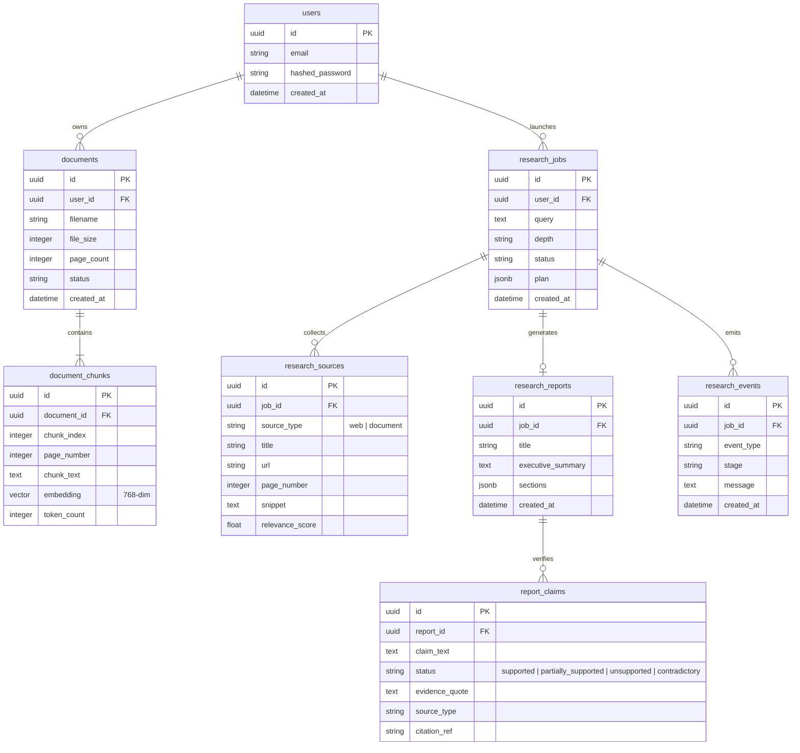

# System Architecture — ResearchPilot

## 1. Overview
ResearchPilot is an institutional-grade, multi-agent AI research platform designed to automate deep research, synthesize evidence from uploaded PDFs and live web sources, verify claims against retrieved facts, and generate cited intelligence reports.

---

## 2. Layered Architecture

```
+-------------------------------------------------------------------------+
|                       Presentation Layer (Frontend)                     |
|  - Vite + React 18 (Pure JavaScript & JSX, NO TypeScript)               |
|  - Tailwind CSS + shadcn/ui JS components                               |
|  - React Router DOM + Axios HTTP Client                                 |
+------------------------------------+------------------------------------+
                                     | HTTP / SSE
                                     v
+-------------------------------------------------------------------------+
|                         API Layer (FastAPI)                             |
|  - Asynchronous REST Routers (/documents, /qa, /research, /health)      |
|  - Request & Response Validation (Pydantic v2)                          |
|  - Global CORS & Exception Middleware                                   |
+------------------------------------+------------------------------------+
                                     |
             +-----------------------+-----------------------+
             |                                               |
             v                                               v
+----------------------------+             +------------------------------+
|     Intelligence Layer     |             |          Data Layer          |
| - LangGraph Workflow Engine|             | - PostgreSQL 16              |
| - Planner Agent            |             | - pgvector 0.6.0 (768 dims)  |
| - Web Research (Tavily)    |             | - PyMuPDF (fitz) parser      |
| - Document RAG Agent       |             | - Alembic Database Migration |
| - Fact Checker Agent       |             +------------------------------+
| - Report Writer Agent      |
| - Provider Abstractions    |
+----------------------------+
```

---

## 3. Multi-Agent Workflow Architecture

ResearchPilot uses **LangGraph** to coordinate 5 specialized autonomous agents through typed states and parallel fan-out routing:


### Agent Roles & Responsibilities

1. **Planner Agent (`PlannerAgent`)**:
   - Decomposes the research topic into 3–5 targeted sub-questions.
   - Categorizes information channels (`web`, `document`, or `both`).
   - Produces structured Pydantic `ResearchPlan`.

2. **Web Research Agent (`WebResearchAgent`)**:
   - Executes targeted searches against the Tavily API.
   - Normalizes snippet contents, deduplicates URLs, and extracts publication dates.
   - Strictly enforces real web source URLs.

3. **Document Research Agent (`DocumentResearchAgent`)**:
   - Converts sub-questions into 768-dimensional query embeddings.
   - Performs cosine similarity search (`<=>`) in PostgreSQL via `pgvector`.
   - Preserves exact originating page numbers (`[Page X]`) and chunk IDs.

4. **Fact Checker Agent (`FactCheckerAgent`)**:
   - Extracts factual assertions from synthesized evidence.
   - Classifies claims into: `supported`, `partially_supported`, `unsupported`, or `contradictory`.
   - Never assumes LLM infallibility; ties every claim to concrete evidence chunks.

5. **Report Writer Agent (`ReportWriterAgent`)**:
   - Compiles findings into an institutional 9-section report.
   - Generates clickable citation pills linking directly to web URLs and PDF pages.
   - Flags limitations, risks, and contradictory viewpoints.

---

## 4. Entity-Relationship Model (ERD)



---

## 5. Security & Isolation Architecture

To safeguard multi-agent workflows from untrusted document uploads and external web content, ResearchPilot applies a **Defense-in-Depth** model:

```
[ External PDF Upload / Scraped Web Text ]
                   │
                   ▼
     ┌────────────────────────────┐
     │      Security Auditor      │
     │  (Regex Injection Filter)  │
     └─────────────┬──────────────┘
                   │ Neutralizes "Ignore previous instructions", "System:", etc.
                   ▼
     ┌────────────────────────────┐
     │ Boundary Enclosure Fencing │
     │  <<<UNTRUSTED_EVIDENCE...  │
     └─────────────┬──────────────┘
                   │ Isolates text as inert evidence data
                   ▼
     ┌────────────────────────────┐
     │ LLM Intelligence Pipeline  │
     └────────────────────────────┘
```

---

## 6. Provider Abstraction Pattern

The application does not couple directly to any single proprietary LLM. All intelligence interactions operate via abstract base interfaces:

- **`LLMProvider`**:
  - `generate(prompt, system_instruction, temperature) -> str`
  - `generate_structured(prompt, schema, system_instruction, temperature) -> BaseModel`
- **`EmbeddingProvider`**:
  - `embed_documents(texts: List[str]) -> List[List[float]]`
  - `embed_query(text: str) -> List[float]`

Current concrete implementations:
- `GeminiProvider` (`gemini-2.5-flash`)
- `GeminiEmbeddingProvider` (`text-embedding-004`, 768 dims)
- `MockLLMProvider` (deterministic offline testing)
- `MockEmbeddingProvider` (deterministic 768-dim hash vector)
