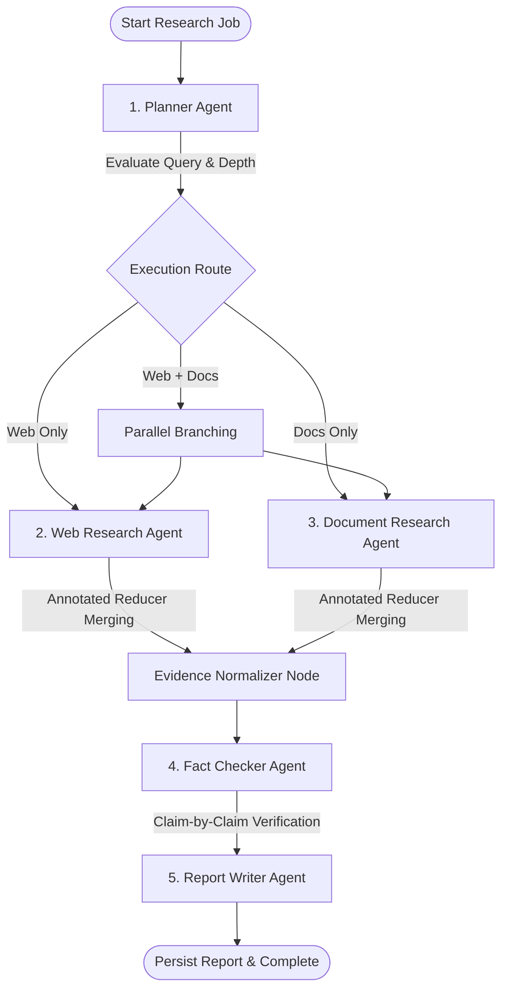
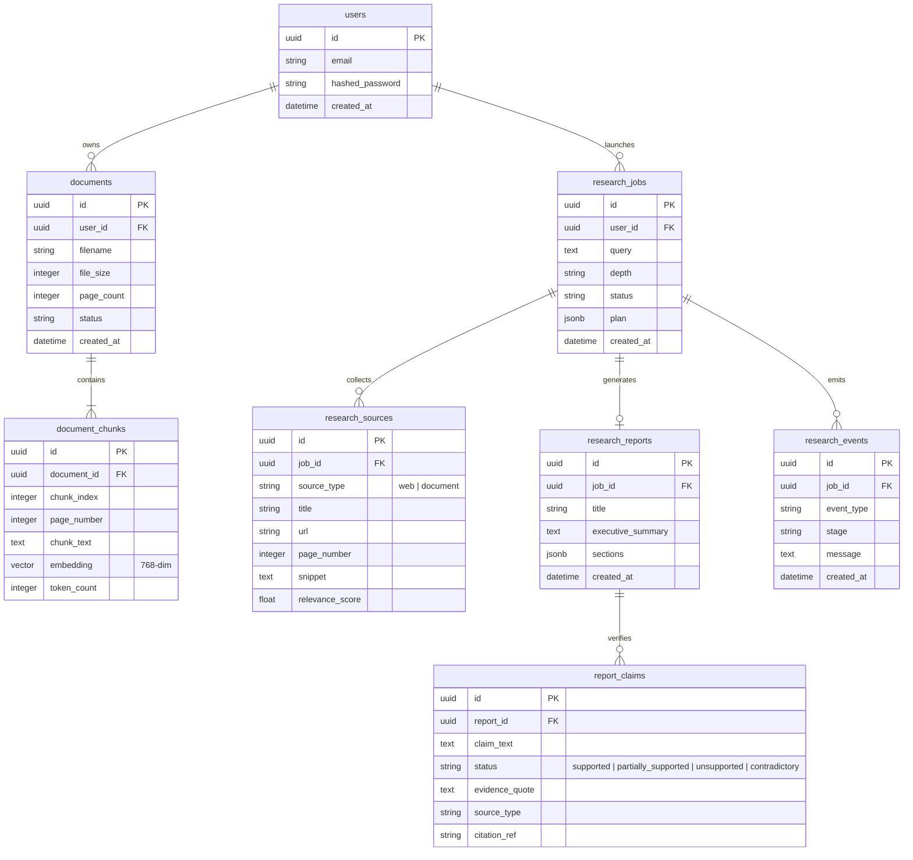
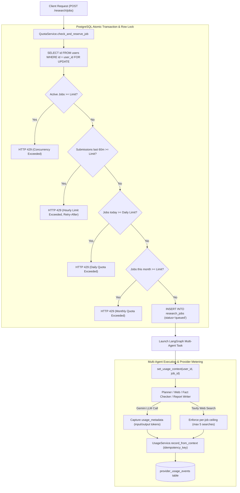
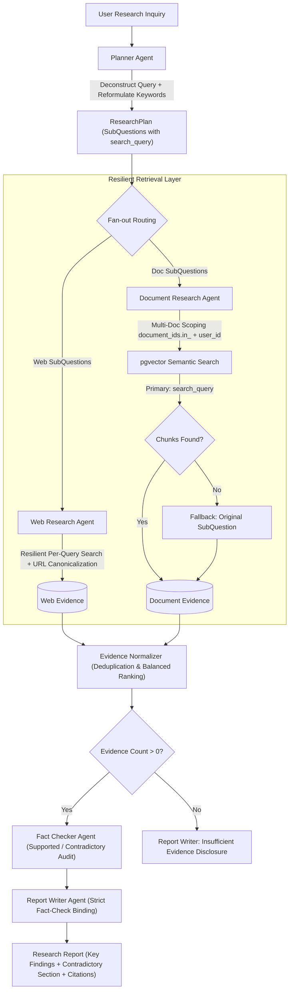
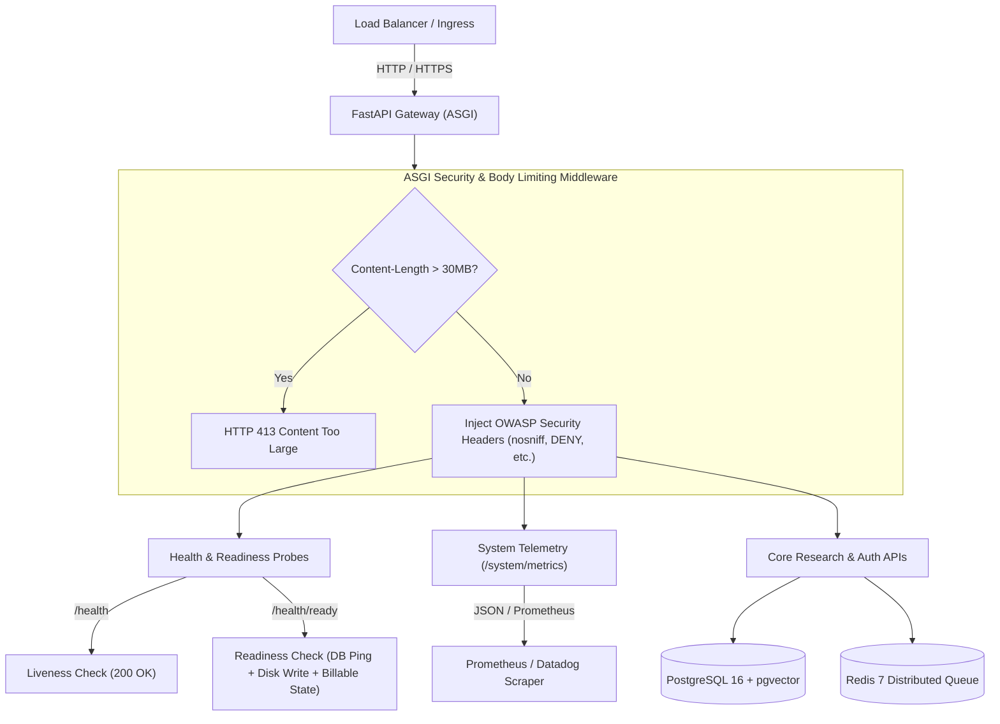
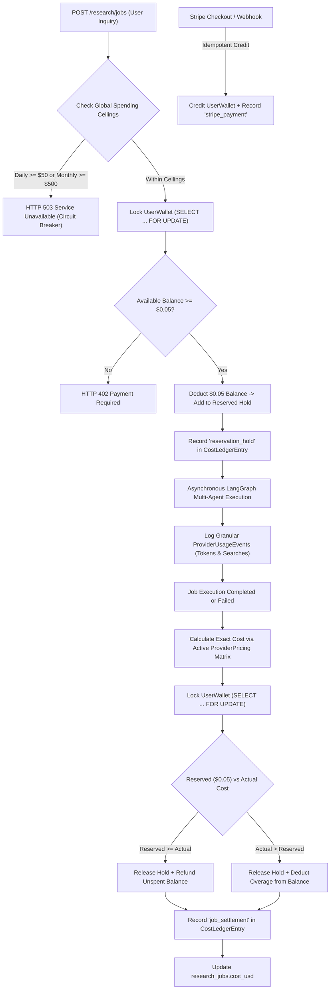

# System Architecture — ResearchPilot

## 1. Overview
ResearchPilot is an institutional-grade, multi-agent AI research platform designed to automate deep research, synthesize evidence from uploaded PDFs and live web sources, verify claims against retrieved facts, and generate cited intelligence reports.

---

## 2. Layered Architecture

```
+-------------------------------------------------------------------------+
|                       Presentation Layer (Frontend)                     |
|  - Vite + React 18 (Pure JavaScript & JSX, NO TypeScript)               |
|  - Tailwind CSS + shadcn/ui JS components                               |
|  - React Router DOM + Axios HTTP Client                                 |
+------------------------------------+------------------------------------+
                                     | HTTP / SSE
                                     v
+-------------------------------------------------------------------------+
|                         API Layer (FastAPI)                             |
|  - Asynchronous REST Routers (/documents, /qa, /research, /health)      |
|  - Request & Response Validation (Pydantic v2)                          |
|  - Global CORS & Exception Middleware                                   |
+------------------------------------+------------------------------------+
                                     |
             +-----------------------+-----------------------+
             |                                               |
             v                                               v
+----------------------------+             +------------------------------+
|     Intelligence Layer     |             |          Data Layer          |
| - LangGraph Workflow Engine|             | - PostgreSQL 16              |
| - Planner Agent            |             | - pgvector 0.6.0 (768 dims)  |
| - Web Research (Tavily)    |             | - PyMuPDF (fitz) parser      |
| - Document RAG Agent       |             | - Alembic Database Migration |
| - Fact Checker Agent       |             +------------------------------+
| - Report Writer Agent      |
| - Provider Abstractions    |
+----------------------------+
```

---

## 3. Multi-Agent Workflow Architecture

ResearchPilot uses **LangGraph** to coordinate 5 specialized autonomous agents through typed states and parallel fan-out routing:



### Agent Roles & Responsibilities

1. **Planner Agent (`PlannerAgent`)**:
   - Decomposes the research topic into 3–5 targeted sub-questions.
   - Categorizes information channels (`web`, `document`, or `both`).
   - Produces structured Pydantic `ResearchPlan`.

2. **Web Research Agent (`WebResearchAgent`)**:
   - Executes targeted searches against the Tavily API.
   - Normalizes snippet contents, deduplicates URLs, and extracts publication dates.
   - Strictly enforces real web source URLs.

3. **Document Research Agent (`DocumentResearchAgent`)**:
   - Converts sub-questions into 768-dimensional query embeddings.
   - Performs cosine similarity search (`<=>`) in PostgreSQL via `pgvector`.
   - Preserves exact originating page numbers (`[Page X]`) and chunk IDs.

4. **Fact Checker Agent (`FactCheckerAgent`)**:
   - Extracts factual assertions from synthesized evidence.
   - Classifies claims into: `supported`, `partially_supported`, `unsupported`, or `contradictory`.
   - Never assumes LLM infallibility; ties every claim to concrete evidence chunks.

5. **Report Writer Agent (`ReportWriterAgent`)**:
   - Compiles findings into an institutional 9-section report.
   - Generates clickable citation pills linking directly to web URLs and PDF pages.
   - Flags limitations, risks, and contradictory viewpoints.

---

## 4. Entity-Relationship Model (ERD)



---

## 5. Security & Isolation Architecture

To safeguard multi-agent workflows from untrusted document uploads and external web content, ResearchPilot applies a **Defense-in-Depth** model:

```
[ External PDF Upload / Scraped Web Text ]
                   │
                   ▼
     ┌────────────────────────────┐
     │      Security Auditor      │
     │  (Regex Injection Filter)  │
     └─────────────┬──────────────┘
                   │ Neutralizes "Ignore previous instructions", "System:", etc.
                   ▼
     ┌────────────────────────────┐
     │ Boundary Enclosure Fencing │
     │  <<<UNTRUSTED_EVIDENCE...  │
     └─────────────┬──────────────┘
                   │ Isolates text as inert evidence data
                   ▼
     ┌────────────────────────────┐
     │ LLM Intelligence Pipeline  │
     └────────────────────────────┘
```

---

## 6. Provider Abstraction Pattern

The application does not couple directly to any single proprietary LLM. All intelligence interactions operate via abstract base interfaces:

- **`LLMProvider`**:
  - `generate(prompt, system_instruction, temperature) -> str`
  - `generate_structured(prompt, schema, system_instruction, temperature) -> BaseModel`
- **`EmbeddingProvider`**:
  - `embed_documents(texts: List[str]) -> List[List[float]]`
  - `embed_query(text: str) -> List[float]`

Current concrete implementations:
- `GeminiProvider` (`gemini-2.5-flash`)
- `GeminiEmbeddingProvider` (`text-embedding-004`, 768 dims)
- `MockLLMProvider` (deterministic offline testing)
- `MockEmbeddingProvider` (deterministic 768-dim hash vector)

---

## 7. Multi-User Authentication & Isolation Architecture (Stage 1)

ResearchPilot enforces strict per-user database isolation, credential security, and anti-enumeration defenses:

```mermaid
flowchart TD
    Client["Client (Browser / React JS)"] -->|1. POST /auth/login| AuthRouter["Auth Endpoint"]
    AuthRouter -->|Verify Bcrypt Hash| UserTable[("users table")]
    AuthRouter -->|Store SHA-256 Hash| RefreshTable[("refresh_tokens table")]
    AuthRouter -->|Issue Access Token (HS256) & Rotated Refresh Token| Client

    Client -->|2. Bearer Token Request /documents or /research| ProtectedAPI["Protected API Endpoints"]
    ProtectedAPI -->|get_current_active_user| TokenVerify["JWT Signature & Expiry Check"]
    TokenVerify -->|Must Change Password Check| PassCheck{"must_change_password?"}
    PassCheck -->|True| Block403["HTTP 403 (X-Must-Change-Password)"]
    PassCheck -->|False| OwnershipFilter["Tenant Ownership Filter"]

    OwnershipFilter -->|WHERE user_id == current_user.id| ScopedDB[("Scoped Records")]
    OwnershipFilter -->|Resource belongs to other user| AntiEnum["HTTP 404 Not Found (Anti-Enumeration)"]
```

### Key Security Safeguards:
1. **SHA-256 Hashed Refresh Tokens**: Refresh tokens are never stored in plaintext in the database.
2. **Token Rotation & Automatic Theft Invalidation**: Every call to `/auth/refresh` issues a fresh token pair and revokes the old token. If an already-revoked refresh token is replayed, the system detects token theft and immediately terminates all active sessions for that user account.
3. **Anti-Enumeration Standard**: Any attempt to access, list, search, or delete a document, chunk, research job, report, or event owned by another user yields `404 Not Found` (never `403 Forbidden`). Attackers cannot enumerate resource existence.
4. **Controlled Account Lifecycle**: Non-destructive `ON DELETE RESTRICT` foreign keys protect historical reports and research audit trails. Deactivating an account immediately revokes all active refresh tokens.
5. **Initial Owner Migration Backfill**: Development documents (23) and research jobs (55) were backfilled to an initial owner account provisioned with mandatory `must_change_password=True`.

---

## 8. Rate Limiting, User Quota Engine & Usage Tracking Architecture (Stage 2)

ResearchPilot enforces backend-controlled rate limits, concurrency gates, and granular provider resource accounting across all users:



### Quota Engine Mechanics:
1. **Zero External Infrastructure Dependencies**: Enforces thread-safe, multi-process concurrency control directly in PostgreSQL using `SELECT ... FOR UPDATE` row-level locks on the `users` table. This guarantees ACID serializability without introducing Redis or external state stores.
2. **Standard HTTP 429 Telemetry**: Rejections return standard `Retry-After: <seconds>` headers alongside structured JSON diagnostics (`error`, `limit_type`, `current_usage`, `limit_value`).
3. **Idempotent Retries**: Research submissions support client tokens (`client_token` or `X-Idempotency-Key` header). Network retries return the pre-existing job without consuming additional quota or triggering concurrency blocks.
4. **Distinction Between Actual and Estimated Metrics**: Usage records capture genuine provider token metadata from `response.usage_metadata` where available. When unavailable (e.g. embedding API response limitations or offline mock simulations), `is_estimated=True` and `usage_metadata_available=False` are explicitly recorded with contextual limitation notes.
5. **Per-Job Web Search Ceilings**: Web search execution is constrained to configurable per-job maximums (default: 5 searches). The agent caps searches gracefully, appending milestone warnings and proceeding with synthesis from available evidence.

---

## 9. Strategic Cost Management Deferral & Revised Roadmap

To maximize product value and core multi-agent research capabilities during early development and beta testing, full monetary cost management is intentionally deferred to Stage 6.

### Essential Provider Safety Checks Active in Current Architecture:
- **Strict Configuration Enforcement**: Configured Gemini LLM and Embedding models are explicitly declared via backend settings (`LLM_MODEL`, `EMBEDDING_MODEL`), preventing silent shifts to unexpected or paid model variants.
- **Provider API Key Confinement**: External API keys (`GEMINI_API_KEY`, `TAVILY_API_KEY`) remain strictly server-side within the backend execution environment; zero credentials or secrets are accessible via client responses or frontend bundles.
- **Quota Failure Handling & Zero Uncontrolled Retries**: Provider quota errors (HTTP 429 / `RESOURCE_EXHAUSTED`) raise typed `ProviderQuotaError` and fail cleanly without uncontrolled retry loops. Network retries are restricted to a single attempt for socket disconnects (`10053`/`10054`).
- **Emergency Billable Kill-Switch (`BILLABLE_OPERATIONS_ENABLED`)**: Simple backend kill-switch in `Settings`. When disabled (`BILLABLE_OPERATIONS_ENABLED=False`), new live API operations are blocked with HTTP 503 while preserving read-only access to existing reports, documents, and usage audit logs.
- **Tavily Per-Job Bound**: Web search queries are capped at 5 searches per research job for Free tier.

### Documented Deferred Features (Scheduled for Stage 6):
- Monetary cost calculation per research job and user.
- Configurable/versioned provider pricing database.
- Atomic monetary budget reservations and balance checks.
- Daily/monthly global spending ceilings and automated alerts.
- Cost reconciliation ledger and administrative spending dashboards.
- Stripe billing and subscription management.

### Revised Development Roadmap:
- **Completed**:
  - Stage 1: Authentication and user-level data isolation.
  - Stage 2: Rate limiting, user quotas and provider usage tracking.
  - Stage 3: Research quality, evaluation, and reliability.
  - Stage 4: VS Code extension and client integration.
  - Stage 5: Production readiness, security, and monitoring.
  - Stage 6: Cost management, global budgets, and monetization.

---

## 10. Research Quality, Evaluation & Reliability Architecture (Stage 3)

ResearchPilot enforces rigorous research quality standards, multi-document semantic filtering, search query reformulation, and fault-tolerant agent execution:



### Key Engineering Invariants:
1. **Multi-Document Semantic Scoping**: Users can select arbitrary subsets of their uploaded documents for targeted research jobs. The backend queries pgvector using `DocumentChunk.document_id.in_(target_uuids)` while strictly filtering on `Document.user_id == user_id`, guaranteeing zero cross-tenant vector leakage.
2. **Search Query Reformulation**: Rather than passing raw conversational sentences to search engines, the Planner Agent generates concise, keyword-optimized search queries (3–6 terms) for each sub-question, maximizing retrieval precision on Tavily and vector indices.
3. **Resilient Retrieval Fallbacks**: In `DocumentResearchAgent`, if an optimized search query fails to retrieve chunks above the similarity threshold (0.2), the system automatically retries with the full sub-question text before concluding no evidence was found.
4. **URL Canonicalization & Deduplication**: Web sources are stripped of anchors (`#...`) and trailing slashes to prevent identical articles from occupying multiple evidence slots.
5. **Zero-Evidence Hallucination Neutralization**: If no verified evidence is retrieved across both web and document stores, `ReportWriterAgent` generates an authoritative "Insufficient Evidence" report with explicit missing data disclosures rather than fabricating citations or hallucinating findings.
6. **Automated Quantitative Benchmark Suite**: The platform features an automated benchmark suite in `backend/tests/test_evaluation.py` measuring Precision@K, Recall@K, Mean Reciprocal Rank (MRR >= 0.85), Normalized Discounted Cumulative Gain (nDCG >= 0.80), cross-user data isolation, and prompt injection defense.

---

## 11. VS Code Extension Architecture & Client Integration (Stage 4)

ResearchPilot provides an independent VS Code extension (`vscode-extension/`) that interfaces with the shared FastAPI backend:

```mermaid
flowchart TD
    subgraph VSCode_Client ["VS Code Extension Host (Node.js 22 / JavaScript)"]
        SidebarView["Sidebar Provider (WebviewView)"]
        ReportViewer["Report Viewer (WebviewPanel)"]
        SelectionAction["Research Selected Text Command"]
        
        SecretStorage[("VS Code SecretStorage")]
        TokenManager["TokenManager"]
        ApiClient["ResearchPilotApiClient (Fetch)"]
        SSEStream["SSEResearchStream"]

        SidebarView <-->|postMessage (Zero Token Exposure)| TokenManager
        SelectionAction --> ApiClient
        TokenManager <--> SecretStorage
        ApiClient --> TokenManager
    end

    subgraph Backend_Endpoints ["FastAPI Backend (Port 8000)"]
        AuthRoute["POST /api/v1/auth/login, refresh"]
        JobRoute["POST /api/v1/research/jobs"]
        SSERoute["GET /api/v1/research/jobs/{id}/stream"]
        ReportRoute["GET /api/v1/research/jobs/{id}/report"]
        UsageRoute["GET /api/v1/usage/me"]

        LangGraph["LangGraph 5-Agent Multi-Agent Engine"]
        PostgresDB[("PostgreSQL 16 + pgvector")]
    end

    ApiClient -->|Bearer JWT HS256| AuthRoute
    ApiClient -->|Bearer JWT HS256| JobRoute
    ApiClient -->|Bearer JWT HS256| ReportRoute
    ApiClient -->|Bearer JWT HS256| UsageRoute
    SSEStream -->|text/event-stream| SSERoute

    JobRoute --> LangGraph
    LangGraph --> PostgresDB
```

### Security & Operational Invariants:
1. **OS Keychain Secret Storage**: All JWT access and refresh tokens are managed via `context.secrets` (`vscode.SecretStorage`). Tokens are never passed into webview HTML or scripts.
2. **Transparent Token Rotation**: The client intercepts `HTTP 401 Unauthorized` responses and silently requests token rotation via `/auth/refresh`, persisting new tokens and re-executing the request.
3. **Explicit Consent on Selection Research**: Selection-based research triggers an explicit confirmation dialog showing the text preview before transmission.
4. **Backend Rate-Limit & Kill-Switch Diagnostics**: Intercepts `HTTP 429` (displaying `Retry-After` seconds) and `HTTP 503` (displaying policy notices) without client-side quota bypasses.
5. **Publication-Grade Markdown Export**: Serializes full structured reports into Markdown documents with formatted claims tables and clickable citations, saving directly to the active workspace.

---

## 12. Production Readiness, Security & Monitoring Architecture (Stage 5)

ResearchPilot incorporates enterprise-grade operational readiness, defense-in-depth security middleware, operational telemetry, and distributed infrastructure scaling.

### Production Topology & Telemetry Flow:



### Production Readiness Capabilities:
1. **Liveness & Readiness Probes**:
   - `GET /api/v1/health`: Verifies basic process responsiveness and database connectivity.
   - `GET /api/v1/health/ready`: Validates database pool liveness, local disk write access for uploads (`UPLOAD_DIR`), billable operations state, and provider readiness. Returns HTTP 200 when ready, HTTP 503 when degraded.
2. **OWASP Security Headers & Payload Controls**:
   - Automatic injection of `X-Content-Type-Options: nosniff`, `X-Frame-Options: DENY`, `X-XSS-Protection: 1; mode=block`, `Referrer-Policy: strict-origin-when-cross-origin`, and `Permissions-Policy`.
   - ASGI-level payload ceiling rejecting requests > 30MB (`MAX_REQUEST_BODY_SIZE_MB = 30`) with `HTTP 413 Content Too Large`.
3. **Prometheus Telemetry Exposition**:
   - `GET /api/v1/system/metrics`: Exposes runtime uptime, resident memory RSS (cross-platform Linux/Windows), job execution counts, knowledge base totals, token counters, and web search counts.
   - Supports both JSON formatting and standard Prometheus exposition format (`format=prometheus` or `Accept: text/plain`).
4. **Redis Queue & Infrastructure Scaling**:
   - Integrated Redis 7 Alpine into `docker-compose.yml` with healthchecks.
   - Configured `REDIS_URL` and `GRACEFUL_SHUTDOWN_TIMEOUT_SECONDS` for distributed worker scaling and crash recovery.
   - Declared container resource limits (`deploy.resources.limits`) for backend, database, redis, and frontend.
5. **Operational Runbooks & Strategy Documents**:
   - [SCALING_STRATEGY.md](file:///f:/Research%20Agent/docs/SCALING_STRATEGY.md): Topology, PgBouncer pool sizing, KEDA queue depth triggers, and decoupling scaling from spending limits.
   - [SECURITY_AND_PRIVACY.md](file:///f:/Research%20Agent/docs/SECURITY_AND_PRIVACY.md): Multi-tenancy isolation, prompt injection boundaries (`<<<UNTRUSTED_EVIDENCE_BOUNDARY>>>`), and emergency kill-switch operational procedures.

---

## 13. Cost Management, Global Budgets & Monetization Architecture (Stage 6)

ResearchPilot enforces closed-loop monetary accounting, versioned provider pricing, atomic budget reservations, system spending ceilings, and Stripe payment processing.

### Monetary Lifecycle & Closed-Loop Settlement Flow:



### Key Architectural Invariants:
1. **Versioned Provider Pricing**: Rates for Gemini tokens (input/output), embeddings, and Tavily searches reside in `ProviderPricing`, versioned and active-flagged for dynamic rate changes without code redeployment.
2. **Atomic Row-Level Reservation**: Research jobs acquire row-level locks on `UserWallet` before starting. Concurrent requests cannot double-spend the same remaining balance.
3. **Closed-Loop Settlement**: All provider usage (tokens, embeddings, searches) is itemized upon completion or failure, calculating actual cost in USD and refunding unspent reservations back to the user's wallet.
4. **Global System Ceilings**: Automated circuit breakers pause billable jobs when global daily (`$50.00`) or monthly (`$500.00`) caps are reached, preventing catastrophic billing surges.
5. **Dual-Mode Stripe Billing**: Supports live Stripe Checkout with cryptographic signature verification and deterministic mock simulation mode for continuous integration testing.
6. **Detailed Reference**: Full architectural specifications, schema designs, and runbooks are available in [COST_MANAGEMENT_AND_MONETIZATION.md](file:///f:/Research%20Agent/docs/COST_MANAGEMENT_AND_MONETIZATION.md).

---

## 14. Final Consolidation & Release Readiness Architecture

ResearchPilot has finalized all deferred security verifications, edge-case hardening, evaluation frameworks, and cross-application integrations:

### 1. In-Flight Budget Ceiling Accounting
The global circuit breaker in `BillingService.check_global_budget_limits` enforces `daily_committed = settled_spend + active_in_flight_holds`. If concurrent in-flight jobs hold reservations that would push total daily expenditure past `GLOBAL_DAILY_BUDGET_USD` ($50.00), incoming submissions are paused with HTTP 503 before reservations are committed.

### 2. Streaming Request Body Enforcement
The ASGI security middleware intercepts chunked streamed payloads lacking `Content-Length`. A cumulative streaming byte counter terminates oversized uploads exceeding `MAX_REQUEST_BODY_SIZE_MB` (30MB) with `HTTP 413 Content Too Large` before memory exhaustion can occur.

### 3. Webview Defense-in-Depth & Selection Protection
VS Code webviews enforce strict `Content-Security-Policy: default-src 'none'; style-src 'unsafe-inline'; script-src 'unsafe-inline';`. Citations validate protocol scheme (`http://` or `https://` only) to block `javascript:...` vectors. Editor text selections are bounded to 20,000 characters with user confirmation.

### 4. Consolidated Test & Quality Metrics
Across all tiers (Backend, React frontend, and VS Code extension), 109 automated tests execute with 100% pass status, 0 failures, and 0 regressions. Full details are documented in [FINAL_TEST_REPORT.md](file:///f:/Research%20Agent/FINAL_TEST_REPORT.md), [RELEASE_CHECKLIST.md](file:///f:/Research%20Agent/RELEASE_CHECKLIST.md), and [KNOWN_LIMITATIONS.md](file:///f:/Research%20Agent/KNOWN_LIMITATIONS.md).


