# ResearchPilot

**ResearchPilot** is an institutional-grade, multi-agent AI research platform that accepts complex research inquiries, gathers multi-modal evidence from uploaded PDF documents and external live web sources, coordinates specialized AI agents using LangGraph, rigorously audits factual claims, and synthesizes 9-section structured analytical reports with verifiable citations.

---

## Architecture Overview

```mermaid
flowchart TD
    User([User Request]) --> NewResearch[New Research Form]
    NewResearch --> JobAPI[Research Job API]
    JobAPI --> JobManager[Research Job Manager]

    subgraph LangGraph Multi-Agent Engine
        direction TB
        Planner[1. Planner Agent]
        WebAgent[2. Web Research Agent<br/>(Tavily API)]
        DocAgent[3. Document Research Agent<br/>(pgvector RAG)]
        Normalizer[Evidence Normalizer & Deduplicator]
        FactChecker[4. Fact Checker Agent<br/>(Claim Verification)]
        ReportWriter[5. Report Writer Agent<br/>(Structured Synthesis)]

        Planner -->|Parallel Fan-Out| WebAgent
        Planner -->|Parallel Fan-Out| DocAgent
        WebAgent --> Normalizer
        DocAgent --> Normalizer
        Normalizer --> FactChecker
        FactChecker --> ReportWriter
    end

    JobManager --> Planner
    ReportWriter --> JobManager
    JobManager --> DB[(PostgreSQL + pgvector)]
    JobManager -.->|Server-Sent Events| LiveUI[Live Execution Stepper & Report Viewer]
```

---

## Platform Feature Showcase

| 1. Executive Intelligence Dashboard | 2. Knowledge Base & Document Repository |
| :---: | :---: |
| 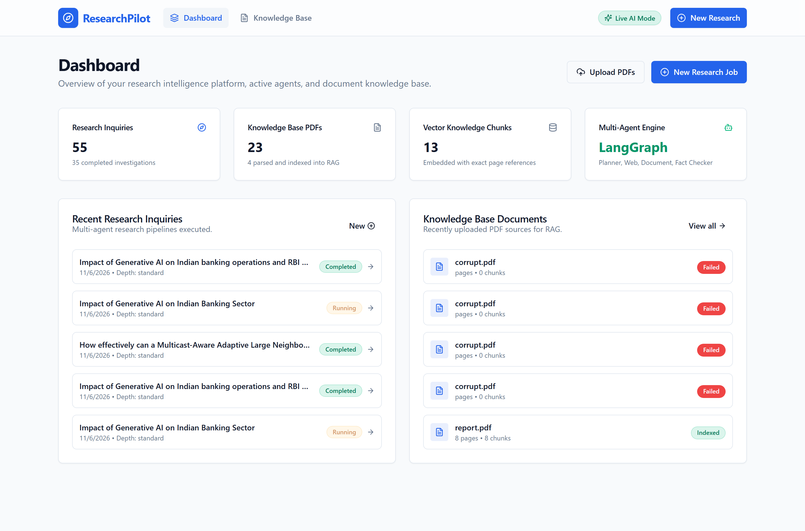 | 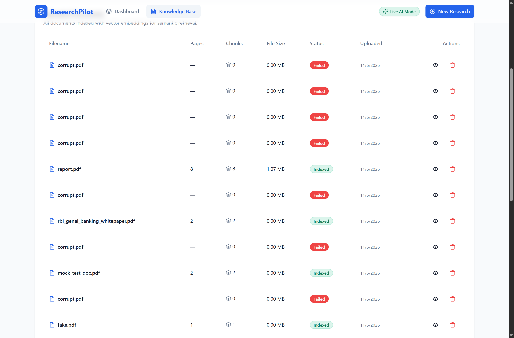 |
| *Real-time telemetry, active provider status, recent investigations, and document knowledge base overview.* | *PDF document ingestion dropzone, PyMuPDF parsing, and pgvector embedding tracking.* |

| 3. Vector Chunk Inspection & Provenance | 4. Grounded Document Q&A / Semantic Search |
| :---: | :---: |
| 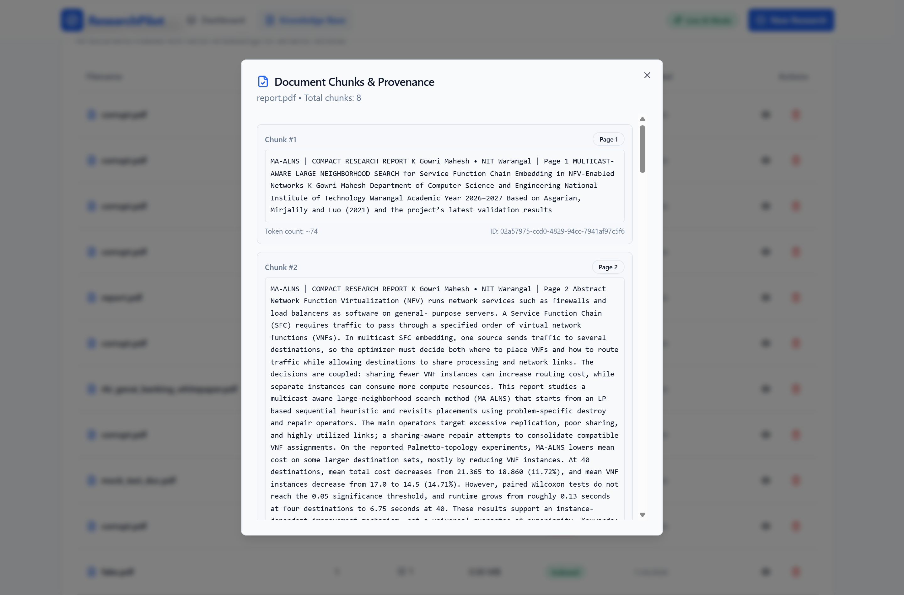 | 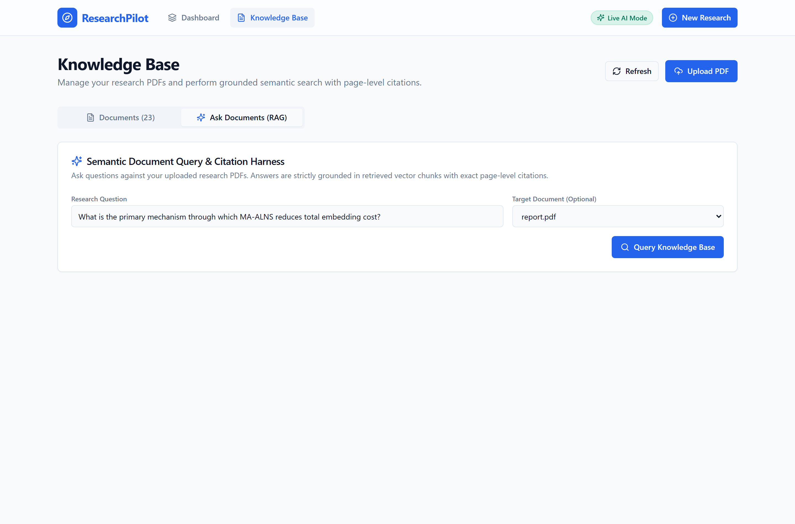 |
| *Granular vector chunk inspection showing exact page coordinates, token counts, and chunk UUIDs.* | *Interactive semantic query harness with physical page citations and grounded vector retrieval.* |

| 5. Multi-Agent Inquiry Configuration | 6. LangGraph Orchestration & Agent Timeline |
| :---: | :---: |
| 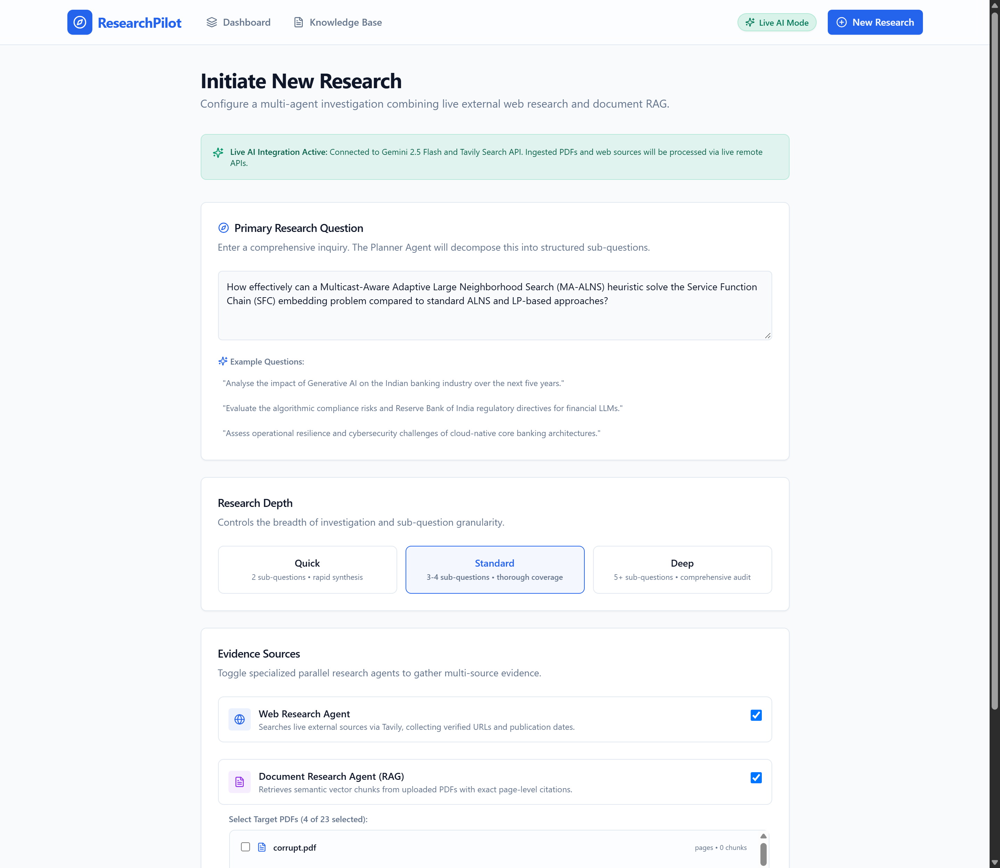 | 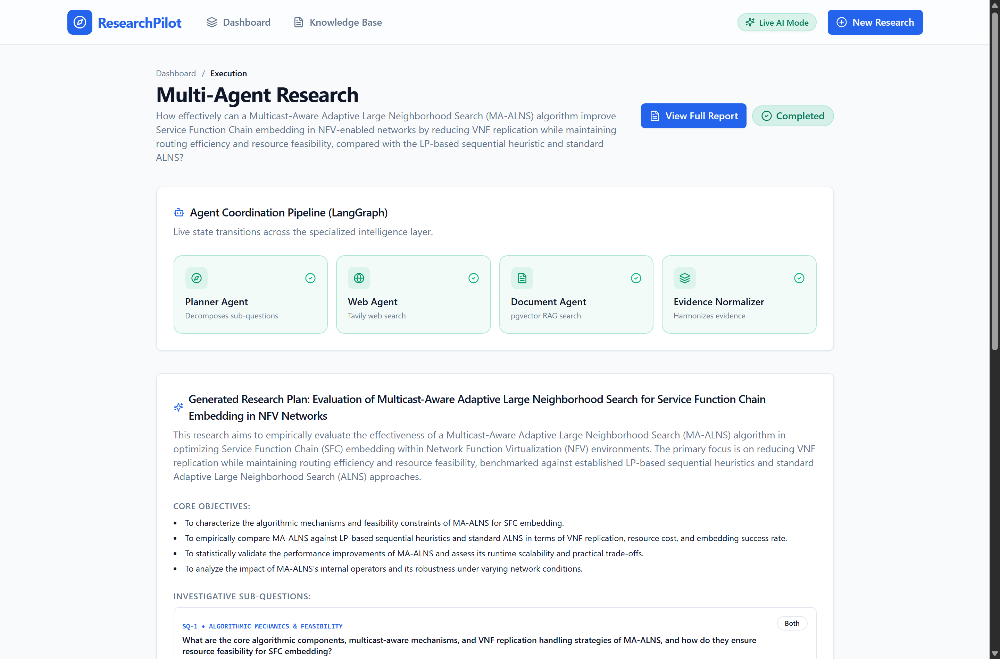 |
| *Inquiry formulation, depth selector (Quick/Standard/Deep), source toggles (Web/Docs), and document picker.* | *Live coordination of Planner, Tavily Web, Document RAG, and Evidence Normalizer agents.* |

| 7. Multi-Agent Milestone Event Stream | 8. Institutional Report Viewer (Executive Fold) |
| :---: | :---: |
| 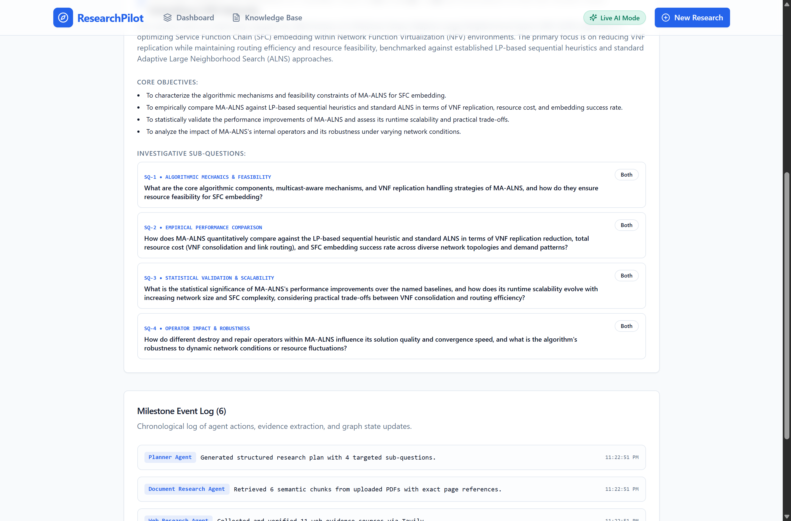 | 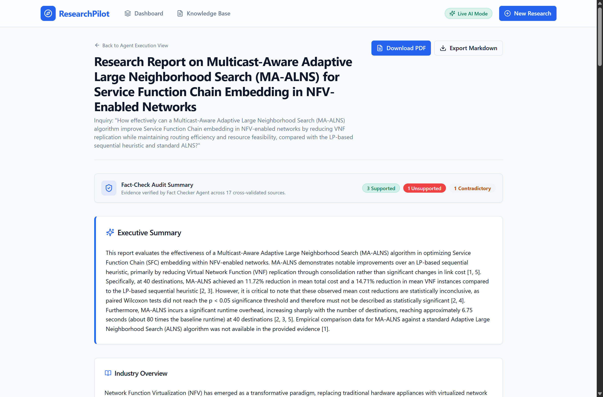 |
| *Decomposed sub-questions (SQ-1 to SQ-4), vector retrieval stats, and web citation stream.* | *Download PDF action, Markdown export, Fact-Check summary badges, and verified executive summary.* |

| 9. Findings & Comparative Baseline Analysis | 10. Contradictory Evidence Guardrail Alert |
| :---: | :---: |
| 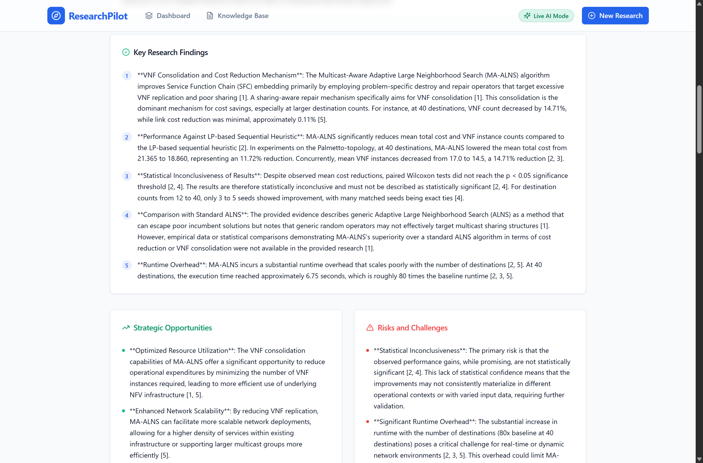 | 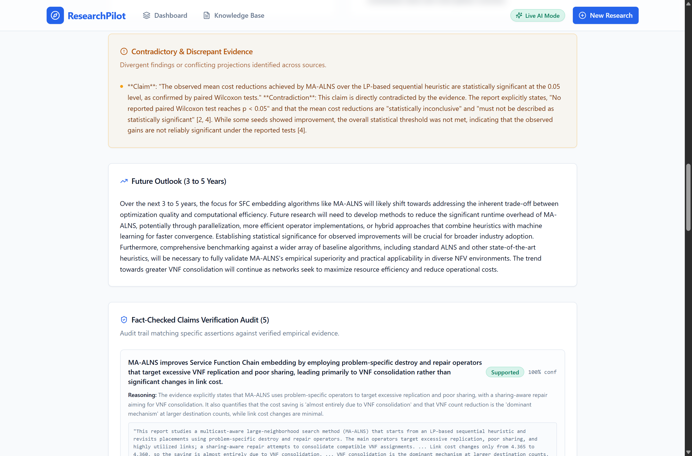 |
| *Structured empirical findings, baseline coverage, and strategic opportunities vs. risks grid.* | *Dedicated guardrail alert highlighting refuted statistical claims and empirical baseline gaps.* |

| 11. Authoritative Claims Verification Audit Matrix | 12. Supporting Evidence & Verifiable Provenance |
| :---: | :---: |
| 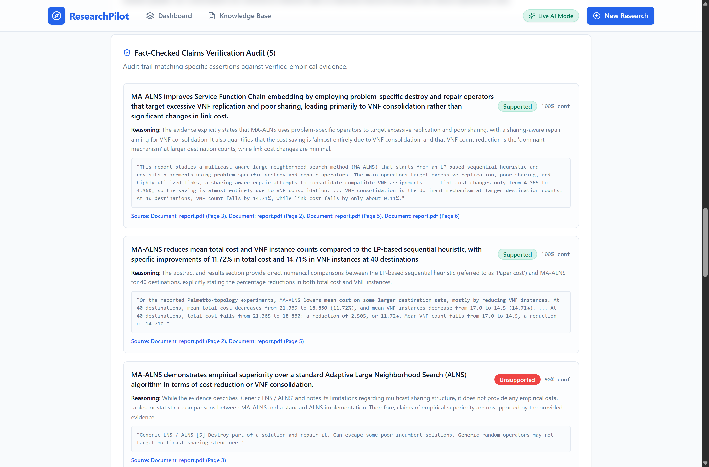 | 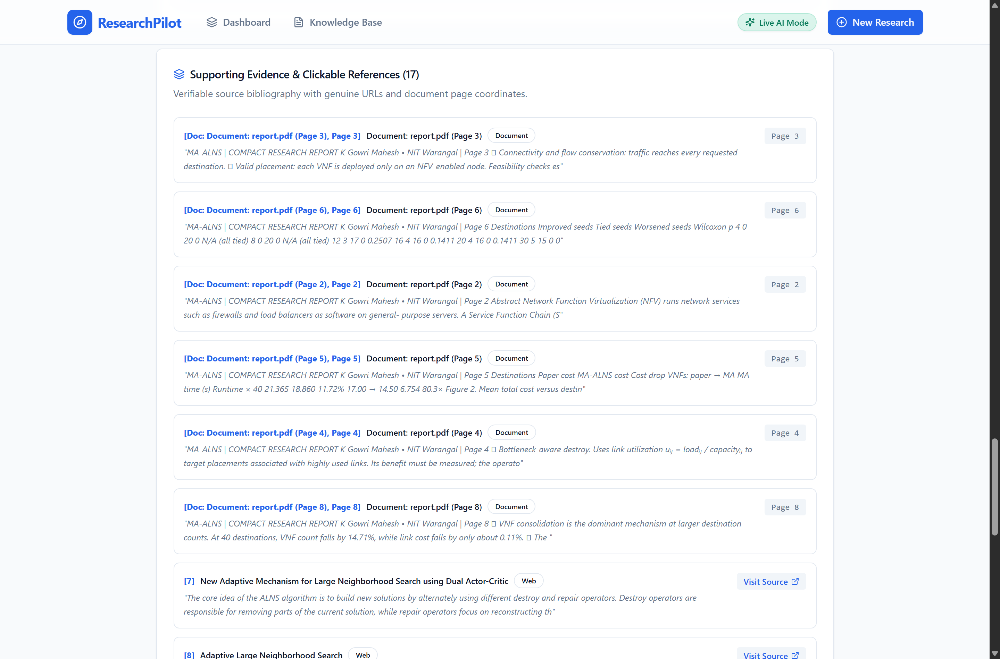 |
| *Fact-checker verification matrix with Supported, Unsupported, and Contradictory badges and quotes.* | *Cross-validated bibliography with live web URLs and physical document page coordinates.* |

| 13. Exported Institutional PDF (Page 1) | 14. Exported Institutional PDF (Page 2) |
| :---: | :---: |
| 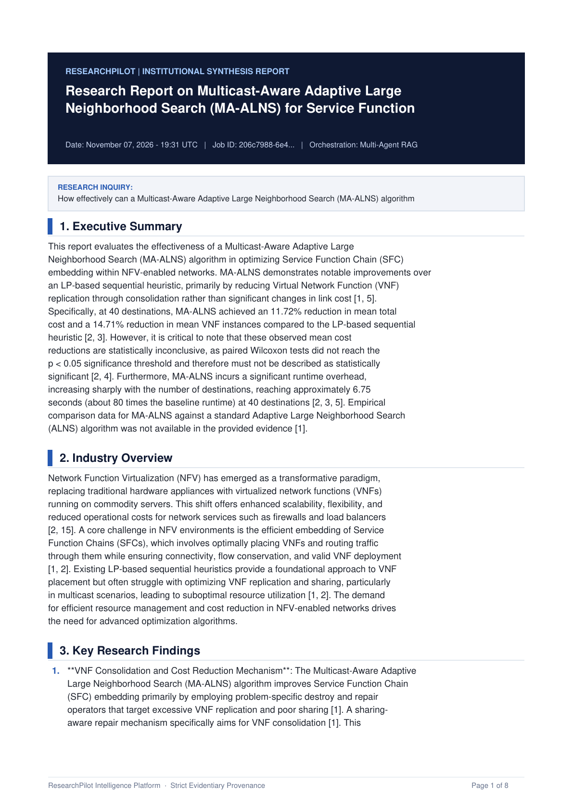 | 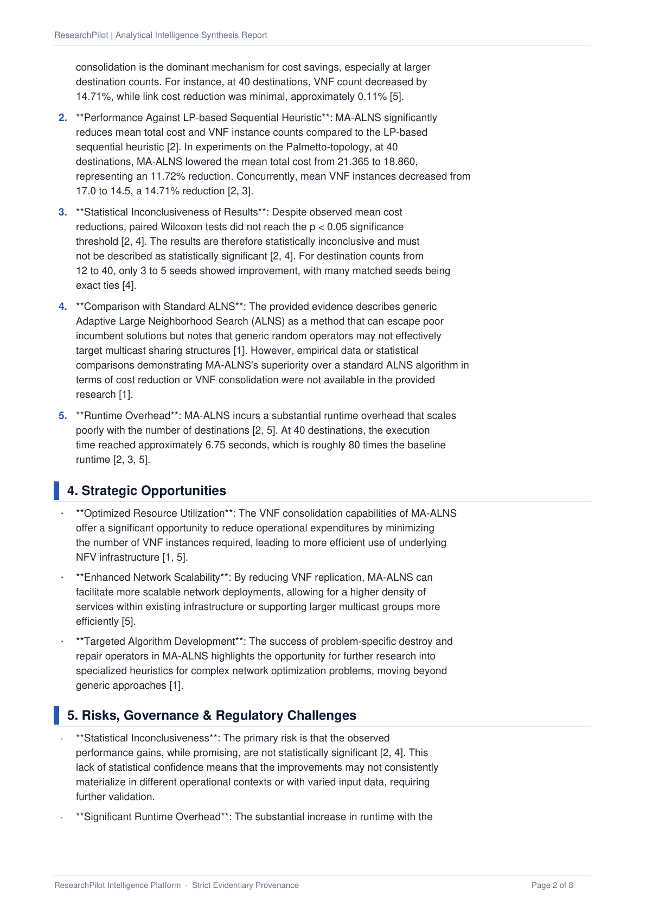 |
| *Professional institutional synthesis report generated via PyMuPDF with header and metadata.* | *Continuation showing Key Findings, Opportunities, and Claims Audit matrix in print format.* |

---

## Key Features

- **Multi-Agent Orchestration**: 5 specialized agents coordinated via LangGraph (`PlannerAgent`, `WebResearchAgent`, `DocumentResearchAgent`, `FactCheckerAgent`, `ReportWriterAgent`).
- **Parallel Evidence Gathering**: Concurrent web searching via Tavily and vector similarity search across ingested PDFs using `pgvector` (`<=>` cosine distance).
- **Exact Citation Provenance**: Every cited document fact links to exact physical page numbers (`[Page X]`) and document UUIDs. Zero fabricated citations.
- **Fact-Checking & Audit Matrix**: Automatically extracts factual claims and classifies them as `supported`, `partially_supported`, `unsupported`, or `contradictory`.
- **Institutional 9-Section Report**: Synthesizes Executive Summary, Industry Overview, Key Findings, Opportunities, Risks/Challenges, Contradictory Findings, Future Outlook, Fact-Check Audit, and Clickable References.
- **Defense-in-Depth Security**: Prompt injection sanitization and context boundary fences (`<<<UNTRUSTED_EVIDENCE_BOUNDARY_START>>>`) preventing indirect instruction overrides.
- **Provider-Agnostic AI**: Decoupled abstract interfaces (`LLMProvider`, `EmbeddingProvider`) supporting Gemini, OpenAI, and deterministic offline mock providers.
- **Pure JavaScript Frontend**: Built with React 18, Vite, Tailwind CSS, and shadcn/ui JS components (strictly **zero** TypeScript files).

---

## Provider Modes: Mock Mode vs Live AI Mode

ResearchPilot is designed to operate seamlessly in two distinct modes:

### 1. Mock Mode (Offline Simulation — Default)
- **Zero API keys required**: Operates out-of-the-box using deterministic local mock models and verified industry research datasets without consuming external tokens.
- **Full multi-agent demonstration**: The entire 5-agent LangGraph workflow (planning, web research, document RAG, fact-checking, 9-section report generation) runs locally.
- **Transparent labeling**: All generated mock plans, simulated claims, and research reports are prefixed with `[MOCK]` to ensure zero confusion with real intelligence.

### 2. Live AI Mode (Authenticated Gemini & Tavily)
- **Live Gemini 2.5 Flash**: Deconstructs questions into structured plans, performs fact-check claim auditing, and synthesizes institutional reports.
- **Live Gemini Embeddings (`text-embedding-004`)**: Generates 768-dimensional vector embeddings for document chunks and queries.
- **Live Tavily Search API**: Gathers live external web evidence with verified source deduplication.
- **No silent fallbacks**: When in Live Mode, invalid keys, quota exhaustion (429), or network errors are surfaced as explicit failures (`ProviderAuthenticationError`, `ProviderQuotaError`) rather than silently generating mock data.

---

## Configuring Live API Keys

To switch from Mock Mode to Live AI Mode:

1. **Obtain a Google Gemini API Key**:
   - Visit [Google AI Studio](https://aistudio.google.com/app/apikey).
   - Sign in and click **"Create API Key"**.
   - Copy the generated key.

2. **Obtain a Tavily Search API Key**:
   - Visit [Tavily AI](https://app.tavily.com/).
   - Sign in and navigate to the dashboard to copy your free API key (starts with `tvly-`).

3. **Configure in `backend/.env`**:
   Open `backend/.env` and update the keys:
   ```env
   PROVIDER_MODE=auto
   GEMINI_API_KEY=your_actual_gemini_api_key_here
   TAVILY_API_KEY=tvly-your_actual_tavily_api_key_here
   ```

4. **Restart the Backend**:
   - Stop the running backend (`Ctrl+C`).
   - Relaunch: `uvicorn app.main:app --reload --host 127.0.0.1 --port 8000`.
   - The frontend Navbar and New Research page will immediately display the green **`[Live AI Mode]`** badge.

---

## Tech Stack

| Layer | Technologies |
| :--- | :--- |
| **Frontend** | React 18, Vite, JavaScript (ES6+), JSX, Tailwind CSS, shadcn/ui (JS), Lucide React, React Router |
| **Backend** | Python 3.13, FastAPI, Pydantic v2, SQLAlchemy 2.0 (async), Alembic, PyMuPDF (`pymupdf`) |
| **Database** | PostgreSQL 16 + `pgvector` 0.6.0 (768-dimensional embeddings) |
| **AI / Multi-Agent** | LangGraph, Gemini API (`gemini-2.5-flash`), Gemini Embeddings (`text-embedding-004`), Tavily Search API |
| **Containerization** | Docker, Docker Compose, Nginx Alpine |
| **Testing** | Pytest, Pytest-Asyncio, Vitest |

---

## Quickstart with Docker Compose

The simplest way to run the full ResearchPilot stack (database, backend, and frontend) is with Docker Compose:

```bash
# 1. Clone or navigate to the repository
cd "Research Agent"

# 2. Configure API keys (optional for mock testing)
cp backend/.env.example backend/.env
# Add GEMINI_API_KEY and TAVILY_API_KEY if testing with live providers

# 3. Start the multi-container stack
docker-compose up --build
```

### Services launched:
- **Frontend SPA**: `http://localhost:3000`
- **Backend API**: `http://localhost:8000` (Interactive Swagger Docs at `http://localhost:8000/docs`)
- **PostgreSQL + pgvector**: `localhost:5432`

---

## Local Development Setup

If you prefer to run services manually on your host machine:

### 1. Database (PostgreSQL 16 + pgvector)
Ensure PostgreSQL 16 with the `pgvector` extension is running:
```sql
CREATE DATABASE researchpilot;
\c researchpilot
CREATE EXTENSION IF NOT EXISTS vector;
```

### 2. Backend Setup
```bash
cd backend

# Create virtual environment
python -m venv venv
# Windows:
.\venv\Scripts\activate
# Linux/macOS:
# source venv/bin/activate

# Install dependencies
pip install -r requirements.txt

# Run migrations
alembic upgrade head

# Start FastAPI server
uvicorn app.main:app --reload --host 127.0.0.1 --port 8000
```

### 3. Frontend Setup
```bash
cd frontend

# Install npm dependencies
npm install

# Start Vite dev server
npm run dev
```
Navigate to `http://localhost:5173`.

---

## API Reference

| Method | Endpoint | Description |
| :--- | :--- | :--- |
| `GET` | `/api/v1/health` | Health check and database connectivity probe |
| `POST` | `/api/v1/documents/upload` | Upload and chunk PDF, compute pgvector embeddings |
| `GET` | `/api/v1/documents` | List all uploaded documents with chunk counts |
| `GET` | `/api/v1/documents/{id}` | Get document metadata and processing status |
| `GET` | `/api/v1/documents/{id}/chunks` | Inspect parsed text chunks, token lengths, and page numbers |
| `DELETE` | `/api/v1/documents/{id}` | Delete document and cascade delete vector chunks |
| `POST` | `/api/v1/qa/query` | Grounded semantic Q&A with physical page citations |
| `POST` | `/api/v1/qa/search` | Raw pgvector cosine similarity search across chunks |
| `POST` | `/api/v1/research/jobs` | Launch LangGraph multi-agent research workflow |
| `GET` | `/api/v1/research/jobs` | List recent research jobs |
| `GET` | `/api/v1/research/jobs/{id}` | Get research job status, metrics, and plan |
| `GET` | `/api/v1/research/jobs/{id}/events` | Get execution event timeline |
| `GET` | `/api/v1/research/jobs/{id}/report` | Retrieve completed 9-section report and claims audit |
| `GET` | `/api/v1/research/jobs/{id}/pdf` | Generate and download publication-ready institutional PDF report |
| `GET` | `/api/v1/research/jobs/{id}/stream` | Server-Sent Events (SSE) live progress updates |

---

## Running the Automated Test Suite

### Backend Tests (21 Unit & Integration Tests)
```bash
cd backend
pytest -v
```

### Frontend Tests (Vitest)
```bash
cd frontend
npm test
```

### Frontend Production Build
```bash
cd frontend
npm run build
```

---

## Evaluation & Benchmark Report

For in-depth benchmark metrics regarding RAG retrieval Precision@K / Recall@K, citation faithfulness, and adversarial prompt injection defenses, see [EVALUATION.md](file:///f:/Research%20Agent/EVALUATION.md).

For architectural decision records, see [DECISIONS.md](file:///f:/Research%20Agent/DECISIONS.md).

For full milestone changelog across all 5 stages, see [PROJECT_LOG.md](file:///f:/Research%20Agent/PROJECT_LOG.md).
